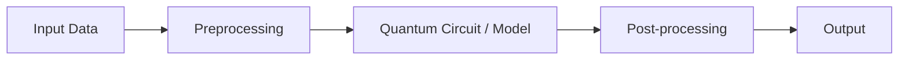

<div align="center">

# Team zen

**VTU-QFF-HC-0080** &nbsp;|&nbsp; Tier: **Online**

</div>

---

<div align="center">

| | |
| :--- | :--- |
| **Team** | Team zen |
| **Team ID** | VTU-QFF-HC-0080 |
| **Tier** | Online |
| **Repository** | [vtu-hc-team-zen](https://github.com/vtu-qiskit-fall-fest-2026/vtu-hc-team-zen.git) |
| **Organisation** | [vtu-qiskit-fall-fest-2026](https://github.com/vtu-qiskit-fall-fest-2026) |
| **Event** | VTU-QFF Hackathon — VTU-Qiskit Fall Fest 2026 |

</div>

---

## 📌 Table of Contents

- [Team Members](#-team-members-github-ids)
- [Problem Statement](#-problem-statement)
- [Proposed Solution](#-proposed-solution)
- [Approach & Architecture](#-approach--architecture)
- [Tech Stack](#-tech-stack)
- [Project Structure](#-project-structure)
- [How to Run](#-how-to-run)
- [How to Push Code](#-how-to-push-code)
- [Submission Checklist](#-submission-checklist)
- [Resources](#-resources)
- [License](#-license)

---

## 👥 Team Members (GitHub IDs)

> Members are added to this repository as **collaborators** and must accept the
> GitHub invitation before they can push. Add your GitHub username below.

| # | Name | GitHub Username | Role |
| :-- | :--- | :--- | :--- |
| 1 | _Channaveer_ | _Channaveer06_ | _Team Lead_ |
| 2 | _Mallikarjun_ | _mallugze_ | _Developer_ |
| 3 | _Akhilesh_ | _akhilesh488-byte_ | _Developer_ |

<!--
Optional: add a plain list instead of the table above.
- @username1
- @username2
-->

---

## ❓ Problem Statement

<!--
State the problem you are solving. Be specific: what is broken or missing,
who experiences it, and why does it matter. Link to the official problem
statement from the brief if one applies.
-->

**Problem:** _High-resolution satellite imagery segmentation for road network extraction demands massive computational overhead, creating severe parameter bottlenecks in classical deep learning models._

**Why it matters:** _These bottlenecks limit real-time processing capabilities for Earth observation and restrict the scalability of models on standard GPU hardware._

**Track / Category:** _Online · Track 4 · <Quantum + AI & ML>_

---

## 💡 Proposed Solution

<!--
Describe your solution. Keep it concrete: the core idea, the user flow, and
the quantum/ML technique you are applying.
-->

**Solution:** _We are developing a Hybrid Quantum-Classical deep learning architecture by embedding Variational Quantum Circuits (VQCs) into the bottleneck layer of a classical Dual-Attention U-Net. Built using Qiskit and PyTorch, this system replaces heavily parameterized classical layers with quantum layers to process complex satellite imagery.._

**Key idea:** _Mapping spatial features into high-dimensional quantum states to drastically reduce parameter dimensionality and accelerate feature extraction._

**Why this works:** _By offloading the most resource-intensive spatial processing to quantum circuits, the model leverages quantum properties to bypass classical GPU memory bottlenecks, achieving computational efficiency without sacrificing the high segmentation accuracy (Dice score) required for precise road extraction._

---

## 🧩 Approach & Architecture

<!--
Walk through how it works. A simple pipeline diagram in text or Mermaid is ideal.
-->



1. **Input** — _High-resolution satellite imagery (RGB/Multispectral) ingested as PyTorch tensor arrays (e.g., [batch, channels, height, width])_
2. **Preprocessing** — _Classical U-Net encoder layers extract initial spatial features, followed by pooling and angle encoding to map the reduced classical data into quantum states_
3. **Quantum core** — _A Qiskit-based Variational Quantum Circuit (VQC) using a parameterized ansatz (such as EfficientSU2 or RealAmplitudes) functioning as the U-Net bottleneck layer_
4. **Post-processing** — _Quantum measurement expectation values are converted back into classical tensors and fed through the classical U-Net decoder (with dual-attention skip connections) to rebuild spatial resolution_
5. **Output** — _A binary segmentation mask (2D matrix) predicting road network pixels, evaluated for accuracy using the Dice score_

---

## 🛠️ Tech Stack

| Layer | Technology |
| :--- | :--- |
| Language | Python 3.11+ |
| Deep Learning | PyTorch, Torchvision |
| Quantum SDK | Qiskit `>=1.0`, Qiskit Machine Learning (TorchConnector), Qiskit Aer |
| Optimisation | Adam (PyTorch) + COBYLA / SPSA (Qiskit) |
| Simulation | AerSimulator (statevector) |
|Evaluation Metrics | Scikit-learn, TorchMetrics (Dice score, IoU)|
| Environment | JupyterLab / VS Code, venv|
| Version control | Git + GitHub |

---

## 📁 Project Structure

vtu-hc-team-zen/
├── README.md              # This file
├── requirements.txt       # Python dependencies
├── src/
│   ├── __init__.py
│   ├── circuit.py         # Quantum circuit construction
│   ├── optimizer.py       # Optimization loop
│   └── main.py            # Entry point


---

## 🚀 How to Run

### Prerequisites

- Python 3.11 or newer
- [Git](https://git-scm.com/downloads)
- A GitHub account (you need collaborator access to this repo)

### 1. Clone the repository

```bash
git clone https://github.com/vtu-qiskit-fall-fest-2026/vtu-hc-team-zen.git
cd vtu-hc-team-zen
```

### 2. Create a virtual environment

```bash
python3 -m venv .venv
source .venv/bin/activate        # Linux / macOS
# .venv\Scripts\activate         # Windows (PowerShell)
```

### 3. Install dependencies

```bash
pip install --upgrade pip
pip install -r requirements.txt
```

### 4. Run

```bash
python -m src.main
```

Or launch the notebook workflow:

```bash
jupyter lab
```

### 5. Run the tests

```bash
pytest -q
```

---

## 🔁 How to Push Code

> Full walkthrough: **[Git & Collaboration Handbook](../vtu-hc-guide-git-and-collaboration)** — collaboration
> workflow, branches, pull requests, reviews and conflict resolution.

### Configure Git (first time only)

```bash
git config --global user.name  "Your Name"
git config --global user.email "you@example.com"
```

### Everyday workflow

```bash
# 1. Get the latest changes
git checkout main
git pull origin main

# 2. Create a branch for your work
git checkout -b feature/my-task

# 3. Commit your work
git add .
git commit -m "feat: add variational circuit for the search problem"

# 4. Push the branch
git push -u origin feature/my-task

# 5. Open a Pull Request on GitHub and request a review
#    https://github.com/vtu-qiskit-fall-fest-2026/vtu-hc-team-zen/compare/main...feature/my-task

# 6. After approval, merge into main
git checkout main
git pull origin main
git branch -d feature/my-task
```

### Commit message convention

| Prefix | Meaning |
| :--- | :--- |
| `feat:` | New feature |
| `fix:` | Bug fix |
| `docs:` | Documentation only |
| `test:` | Adding or fixing tests |
| `refactor:` | Code restructure, no behaviour change |
| `chore:` | Build/config/dependency changes |

### Useful commands

```bash
git status              # what changed
git log --oneline -10   # recent commits
git diff                # review changes before committing
git stash               # shelve changes temporarily
git pull --rebase       # update your branch on top of main
```

### Collaborating on the same repo

- **Never push directly to `main`** — open a Pull Request.
- **Pull before you push** to avoid rejected commits.
- **Commit often** with clear messages.
- **Resolve conflicts** locally: `git pull --rebase`, fix the files, then `git add` + `git rebase --continue`.
- **Ask for a review** before merging — a second pair of eyes catches bugs fast.

---

## ✅ Submission Checklist

- [ ] Repository created and **public**
- [ ] All team members added as **collaborators** and invitations accepted
- [ ] `README.md` updated with project details, problem statement and solution
- [ ] Team members listed under [Team Members](#-team-members-github-ids)
- [ ] `requirements.txt` committed and project runs from a clean clone
- [ ] Code pushed to `main` and the latest `main` builds successfully
- [ ] Notebooks committed with **cleared outputs** (or use `nbstrip`)
- [ ] `README` includes a demo screenshot / video link
- [ ] Short project summary submitted on the hackathon portal

---

## 📚 Resources

| Resource | Link |
| :--- | :--- |
| 🔁 Git & collaboration handbook | [Git & Collaboration Handbook](../vtu-hc-guide-git-and-collaboration) |
| ❓ Problem statements, solutions & terms | [Problem Statements, Solutions & Terms](../vtu-hc-guide-problem-and-solution) |
| 📄 README writing guide | [README Guide & Template](../vtu-hc-guide-readme-template) |
| ⚛️ Qiskit documentation | https://docs.quantum.ibm.com/ |
| ⚛️ Qiskit Runtime & primitives | https://quantum.cloud.ibm.com/docs/ |
| 🧪 Qiskit Aer simulator | https://docs.quantum.ibm.com/guides/simulator |
| 💻 IBM Quantum Platform | https://quantum.cloud.ibm.com/ |
| 🎓 Qiskit textbook | https://qiskit.qotlabs.org/learning/ |
| 📋 GitHub Docs | https://docs.github.com/ |

---

## 📄 License

Released under the [MIT License](LICENSE). See `LICENSE` for details.

---

<div align="center">

**Team zen** · Team ID `VTU-QFF-HC-0080` · Tier `Online`
· Built with ⚛️ Qiskit for the VTU-QFF Hackathon

[⬆ Back to Top](#team-zen)

</div>
